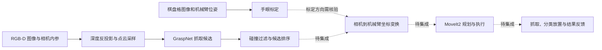

# Sorting-Robot｜视觉抓取与双臂分拣机器人

BUAA sorting-robot 项目。现有内容包括 **GraspNet 点云抓取检测、OpenCV 手眼标定、ROS2 / MoveIt2 双臂运动控制**。

## 技术路线



实线表示已有模块内部的数据流程，虚线表示待核验或待集成环节。GraspNet 已有离线示例；实时相机节点、类别识别、候选到控制接口、分拣状态机均待补齐。

## 仓库结构

```text
Sorting-Robot/
├── README.md
├── docs/
│   ├── technical-roadmap.md        # 技术路线、接口与阶段验收
│   ├── repository-structure.md     # 模块职责、迁移映射与整理原则
│   ├── getting-started.md          # 按现有代码编写的运行说明
│   ├── known-issues.md             # 代码问题与未实现能力
│   ├── source-manifest.json        # 原始归档、逐文件哈希及去向
│   └── verification-report.md      # 本次实际校验结果
├── modules/
│   ├── calibration/
│   │   └── hand_eye_calibration.py
│   └── motion/
│       └── kinova_motion_moveit/   # 双臂控制脚本与原始使用说明
├── third_party/
│   └── graspnet-baseline/          # 已解压，保留上游目录与 LICENSE
├── archives/
│   ├── graspnet-baseline-main.zip  # 原始压缩包，完整保留
│   ├── kinova_motion_moveit.zip    # 原始压缩包，完整保留
│   └── legacy/                    # 空占位文件、旧 README、历史复件
└── tools/
    └── verify_repository.py        # 不连接硬件的完整性与静态检查
```

## 阅读与检查

1. [技术路线](docs/technical-roadmap.md)：已有能力、数据流、坐标关系与下一步开发顺序。
2. [运行说明](docs/getting-started.md)：GraspNet、标定和运动模块的使用前提。
3. [已知问题](docs/known-issues.md)：标定方向、ROS2 包缺失、避障与灵巧手接口问题。
4. [结构与迁移记录](docs/repository-structure.md)、[校验报告](docs/verification-report.md)。

在仓库根目录执行静态校验：

```bash
python3 tools/verify_repository.py
```

这会检查 Python 语法、Shell 语法、原始 ZIP 完整性、解压文件哈希及文档链接，不会导入控制模块或发送机器人指令。完整推理与机器人联调尚未验证。

## 依赖与来源

感知模块使用 PyTorch、Open3D、GraspNet API 以及 PointNet2 / KNN 自定义算子；运动模块使用 ROS2、pymoveit2、MoveIt2 与机器人工作空间；标定使用 NumPy、OpenCV 和 Matplotlib。依赖应分别管理，不能仅安装 GraspNet 的 requirements 就运行整个项目。

原仓库：[venom049/Sorting-Robot](https://github.com/venom049/Sorting-Robot)。本次基于的精确提交见 [来源清单](docs/source-manifest.json)。GraspNet 的原始说明和许可保留在 [third_party/graspnet-baseline](third_party/graspnet-baseline/README.md) 中；仓库未提供覆盖全部自有代码的统一许可证。
