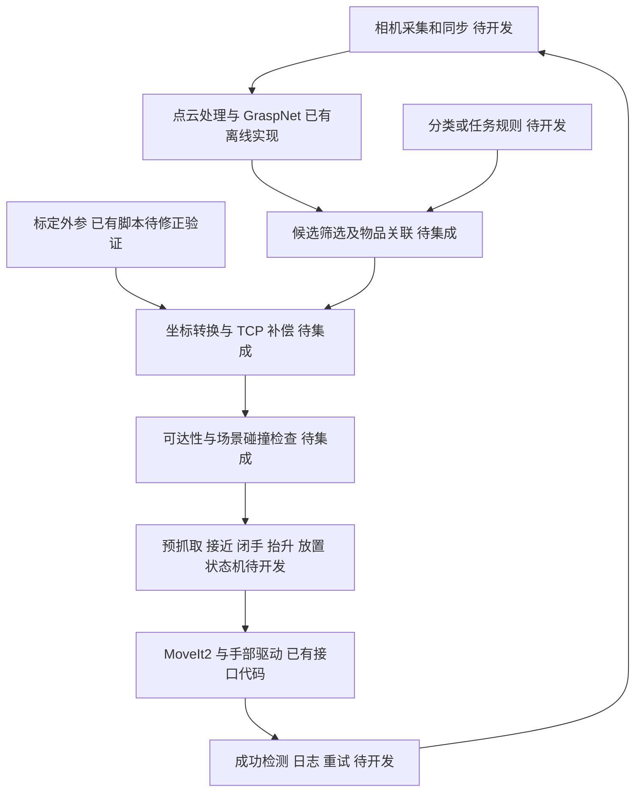

# 项目技术路线

本说明依据本次下载的源码与两个 ZIP 的实际内容编写。文件中的算法名称、历史运行记录与实际完成程度分别判断；原有 SUCCESS_SUMMARY 等文档不构成本次复现实验结果。

## 1. 项目定位与现状

目标可归纳为：利用 RGB-D 感知生成物体抓取姿态，将其转换到机器人坐标系，由双臂和末端执行器完成抓取与分类放置。

**当前阶段：感知、标定、运动控制模块已分别存在，系统集成尚未闭环。**

| 模块 | 仓库中已有内容 | 当前边界 |
| --- | --- | --- |
| RGB-D 数据处理 | GraspNet 离线彩色图、深度图、掩膜和内参示例 | 未见相机实时采集、同步或 ROS2 图像订阅节点 |
| 抓取感知 | PointNet++ 骨干、GraspNet 两阶段预测、碰撞过滤、NMS、分数排序 | 无随仓库提供的模型权重；默认输出为可视化 |
| 手眼标定 | 棋盘格检测、PnP、Tsai 标定调用、残差显示、矩阵保存 | 缺少真实采集数据；变换方向存在问题，不能直接用于机器人 |
| 运动控制 | 双臂关节控制、笛卡尔目标、轨迹点、IK、RRT* 示例 | 缺 ROS2 包元数据、驱动、URDF/SRDF、完整 MoveIt 配置 |
| 末端执行器 | Linker Hand SDK 导入和手部话题发布代码 | 初始化门控导致手部动作被跳过；未形成抓取反馈闭环 |
| 分拣策略 | 未见对应业务实现 | 缺少类别/目标箱映射、任务调度、成功判断、失败重试 |

运动目录名使用 Kinova，部分脚本的注释和工作空间限制却使用 EA200；仅凭目录名无法确认实机型号。双臂各 7 个关节、规划组和末端坐标名称均需与实际机器人描述核对。

## 2. 感知路线：RGB-D → 三维抓取候选

主要入口：`third_party/graspnet-baseline/demo.py`。

1. 读取 `color.png`、`depth.png`、`workspace_mask.png`、`meta.mat`，从元数据取相机内参和深度比例。
2. `utils/data_utils.py` 将深度反投影为相机坐标系点云：`z = depth / factor_depth`，`x = (u-cx)z/fx`，`y = (v-cy)z/fy`。
3. 利用工作空间掩膜和有效深度筛选点，默认随机采样 20,000 点。
4. `models/backbone.py` 的 PointNet++ 提取点云特征。Demo 的 `input_feature_dim=0`，网络输入主要为 XYZ；RGB 用于点云显示，不应写成已实现 RGB 特征融合。
5. `models/graspnet.py`：第一阶段估计可抓取点及接近方向，第二阶段通过局部点云裁剪预测角度、宽度、深度、质量和容差。Demo 默认 300 个视角、12 个角度档、4 个深度档。
6. `utils/collision_detector.py` 按场景点云过滤候选；`vis_grasps()` 执行 NMS 和按分数排序，显示前 50 个候选。

已有训练入口 `train.py`、测试/评估入口 `test.py`、容差标签生成脚本。分拣集成的首个里程碑应先复现预训练模型离线推理，再接实时相机；训练并非首次集成的必要前置工作。

**重要接口缺口：** 当前 Demo 没有向运动模块发布抓取结果。候选需要增加 `frame_id`、采集时间、抓取位姿、宽度、分数，并关联待分拣对象。预测解码中的 `object_id` 被设为 `-1`，不能视作已有物品分类结果。GraspNet 的平行夹爪表示还需要适配灵巧手实际 TCP 与手形。

## 3. 标定路线：棋盘格 → 相机与机器人外参

入口：`modules/calibration/hand_eye_calibration.py`。

现有流程：读取 `./1/` 下的图像 → 图像增强和多方案角点检测 → 亚像素优化 → `solvePnP` → 机器人欧拉角/厘米位姿转齐次矩阵 → `calibrateHandEye`（Tsai）→ 计算一致性残差 → 保存 `hand_eye_matrix.npy` 与文本结果。

源码硬编码内角点数 `(5,8)`、格长 2.5 cm、相机内参与 3 组机器人位姿，全部需要换成真实实验参数；图像按文件名排序后逐项配对，建议使用显式样本清单替代隐式配对。

统一记号：`T_A_B` 把 B 坐标系中的点转换到 A。设 b=机器人基座，g=机器人末端，c=相机，t=标定板，h=抓取参考系。

固定外置相机、标定板固定在末端时，应满足：

```text
T_b_c · T_c_t(i) = T_b_g(i) · T_g_t
```

当前脚本将 PnP 得到的 `T_c_t` 取逆后作为 `target2cam`，又直接把标定返回值命名为 `T_base_cam`。这些方向不能仅由变量名成立，需要按安装方式重新推导并验证。OpenCV 对这些输入与输出有明确坐标定义，见 [calibrateHandEye 官方文档](https://docs.opencv.org/4.10.0/d9/d0c/group__calib3d.html)。

推荐下一步：先明确眼在手外/眼在手上与标定板安装方式，再修正求解输入；使用已知真值的合成位姿验证方向，随后用独立采集样本验证残差和重复定位误差。当前矩阵不能当作已验收的控制外参。

固定相机获得可靠外参后，候选转换为：

```text
T_b_h = T_b_c · T_c_h
T_b_g = T_b_h · inverse(T_g_h)
```

`T_g_h` 为末端到抓取参考系的固定安装变换，需结合 TCP 和抓取定义标定。双臂分别使用各自基座变换，或先转换到共同 world 坐标系。眼在手上的情况则需要实时末端位姿参与，不能直接复用固定外参公式。

## 4. 运动路线：目标位姿 → 规划与执行

目录：`modules/motion/kinova_motion_moveit/`。

| 文件 | 可复用内容 |
| --- | --- |
| `motion_joint_dualarm.py` | 读取关节状态、角度转弧度、左右臂关节目标控制 |
| `motion_cartesian_simple.py` | 位姿输入、工作空间粗筛、欧拉角转四元数 |
| `motion_cartesian_smart.py` | `/compute_ik` 服务、按关节名称解析 IK、连续性处理、虚拟墙 |
| `motion_cartesian_roundtrip.py` | 往返运动与关节变化约束 |
| `motion_trajectory_dualarm.py` | 预设关节轨迹点依次执行 |
| `motion_obstacle_avoidance.py` | 三维位置空间 RRT*、球形障碍、路径点逐点发送 |
| `motion_joint_dualarm_hand.py` | 双臂运动与灵巧手动作框架 |

底层使用 `rclpy`、`pymoveit2.MoveIt2` 和多线程执行器；规划组为 `left_arm` / `right_arm`，基座为 `left_base_link` / `right_base_link`，末端为 `left_tool_frame` / `right_tool_frame`。多数脚本把 MoveIt 规划器 ID 设为 `RRTConnect`；手写 RRT* 是额外的三维位置路径层，不能把两者混写。

当前 RRT* 示例使用固定球形障碍和默认起点，并非已完成动态感知避障或双臂全身联合规划。MoveIt 实际执行的各段轨迹也需要在完整机器人 PlanningScene 中检查；点路径不等于机械臂所有连杆无碰撞。

## 5. 需要补齐的系统数据流



建议接口契约（尚未在仓库实现）：

| 数据 | 必需字段/约束 |
| --- | --- |
| RGB-D 样本 | RGB、对齐深度、内参、深度比例、时间戳、相机坐标系 |
| 抓取候选 | 相机系位姿、score、width、depth、目标关联 ID；位置统一米 |
| 机器人目标 | 目标基座系位姿、TCP 定义、执行手臂、速度/加速度限制 |
| 分拣任务 | 对象类别或规则、目标箱位姿、预抓取/放置偏移、失败策略 |
| 执行反馈 | 规划结果、执行结果、手部状态、抓取/放置验证结果 |

## 6. 推荐开发顺序与验收

| 阶段 | 工作 | 验收产物 |
| --- | --- | --- |
| M0 基线可追溯 | 完成本次目录整理、解压、来源记录、静态校验 | 文件哈希与检查报告；本次已完成 |
| M1 感知复现 | 固定依赖组合、编译算子、准备权重、运行示例 | 可重复的离线候选结果、耗时与运行环境记录 |
| M2 标定可靠 | 修正方向、显式配对、采集多姿态样本 | 合成数据真值验证、独立样本残差与外参版本 |
| M3 单臂闭环 | 接真实位姿/TF、统一 TCP、完善手部初始化 | 仿真中的预抓取→抓取→抬升→放置流程和失败分支 |
| M4 自动分拣 | 接实时相机、类别或任务规则、目标箱映射 | 多物体分类放置、重试、成功率和周期统计 |
| M5 双臂与场景 | 完整碰撞场景、双臂任务分配、协调执行 | 双臂冲突处理、场景变更和故障恢复的实验记录 |

指标至少记录：感知耗时、标定位置/角度残差、规划成功率、抓取成功率、分类正确率、放置成功率、单次分拣周期。阈值需由设备、物体尺寸与实验要求确定；本次没有真实实验数据，不给出虚构精度或性能结果。
